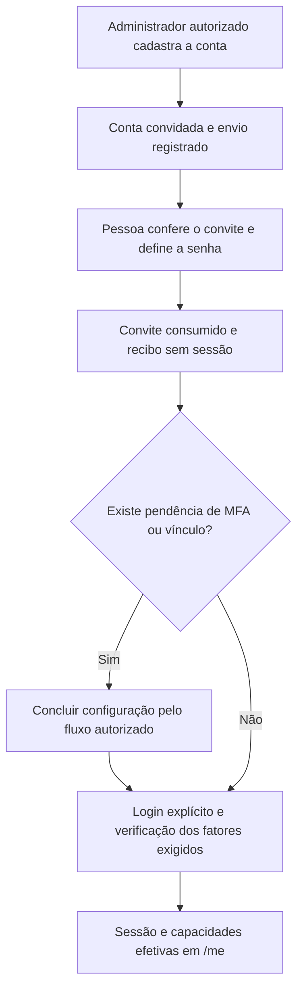

# Prompt de alinhamento e implementação do backend — Ampara SESMT

Atualização de 03/11/2026 na branch `codex/fullstack-atualizado`: este prompt conserva o diagnóstico histórico abaixo. O contrato atual está em `INTEGRACAO.md` e nos fontes `backend/`. Já há edição profissional do trabalhador, gestão nativa de acessos, catálogo/entregas/devoluções de EPI, registro administrativo de treinamentos com renovação/histórico/invalidação e autorização explícita de agenda e designações. Use `epi:ler/criar/editar`, `treinamento:ler/criar/editar`, `agenda:ler/criar/editar` e `designacao:ler/editar`; a permissão de editar PT não substitui essas concessões. A lista de responsáveis da agenda usa `/appointments/{id}/responsibles`. A migration `20261103113512_AddTrainingRecords` integra esta entrega. ASO, certificação de cursos, AT e PET continuam com integração própria pendente. Não implemente novamente um recurso sem comparar o checkout recebido com essa versão.

Referência: frontend 0.5.0 e backend incorporado à branch `Teste`, commit de partida `0246846`; atualizado em 24/10/2026. Este texto pode ser encaminhado à equipe de backend ou usado como prompt de trabalho no checkout da API. Confira alterações posteriores antes de implementar.

---

Você é responsável pelo backend do **Ampara SESMT**, um sistema de gestão de segurança e saúde no trabalho. Sua missão é compreender o frontend existente, fechar o ciclo real de contas e acessos, alinhar os contratos e implementar os fluxos com persistência e validações no servidor.

Use as informações abaixo como contexto de produto e integração. O frontend e os fontes do backend foram inspecionados para este alinhamento; a execução com PostgreSQL ainda não foi homologada. Primeiro confira o checkout recebido, preserve as implementações compatíveis e registre as diferenças. Não presuma que um recurso está concluído por compilar, ter teste com serviços substituídos ou aparecer em uma tela demonstrativa.

Trabalhe no backend e em seus contratos, migrations, testes e documentação. Preserve o layout, os componentes e os fluxos já existentes do frontend. Quando uma mudança de contrato exigir interface nova, entregue a especificação e identifique a dependência; não altere a experiência unilateralmente. Não substitua dados reais por fixtures para apresentar uma integração como concluída.

## 0. Ponto de partida e primeira entrega

### O que já existe e precisa ser aproveitado

| Item | Situação verificada no código / limite da evidência |
| --- | --- |
| Checkout | Frontend na raiz e backend em `SESMT-backend/`, incorporados na branch `Teste`. Isso não significa que todos os módulos estejam integrados. |
| Stack backend | .NET 10, camadas API/Application/Domain/Infrastructure, EF Core e PostgreSQL. Preservar a estrutura existente. |
| API nativa | Já existem autenticação, recuperação de senha e controllers de usuários, organização, trabalhadores, equipes, documentos, auditoria e PT. Suas rotas e DTOs não são automaticamente compatíveis com o frontend. |
| Ponte de sessão | `BrowserSessionController` já expõe `GET /api/v1/auth/csrf`, `POST /api/v1/auth/login`, `/refresh`, `/logout` e `GET /api/v1/me`, reutilizando os serviços existentes. Não reimplementar essa base do zero. |
| Cookies e CSRF | O refresh do navegador está em cookie HttpOnly `ampara.refresh`, caminho `/api/v1/auth`, SameSite Strict e Secure fora de Development ou quando HTTPS. O token CSRF é obtido pelo cliente e enviado em `X-CSRF-Token`. O bearer continua em memória. |
| `/me` atual | Consulta a identidade, devolve os perfis nativos e as referências diretas de empresa/unidade/setor. Retorna `permissions: []` deliberadamente; não expande empresa em todas as unidades e não fornece restrição de equipes/vigência completa. |
| Navegação integrada | Com API e nenhuma capacidade de módulo concedida, o frontend encaminha para `/app/conexao`. Não preencher permissões fictícias só para abrir o menu. |
| Recursos pendentes | Rotas de navegador ainda não adaptadas respondem `501 INTEGRATION_PENDING`. Não remover esse bloqueio sem implementar e autorizar o recurso correspondente. |
| MFA | O navegador recebe bloqueio `403 MFA_REQUIRED` quando a conta tem `MfaEnabled`. Isso ainda não é um desafio MFA verificável: faltam verificação, primeiro enrolamento e recuperação. O seed atual não impõe MFA automaticamente a todo ADMIN. |
| Administrador inicial atual | O seed usa identidade/senha configuradas, cria ADMIN com atribuição global `CompanyId: null` e não cria convite ou escopos organizacionais explícitos. Não confundir esse mecanismo local com o bootstrap-alvo por ativação descrito abaixo. |
| Usuários nativos | `CreateUserRequest` usa `name`, `email`, `roles`, `scopeIds`; a resposta usa `name`, `scopeIds`, `active`, sem os estados/revisões do `UserDto`. A listagem é array. A criação grava uma senha aleatória não entregue e remete à recuperação; isso não implementa o convite de conta do frontend. |
| Primeiro acesso | `/ativar-acesso` e a consulta administrativa do convite existem com MSW. No modo API, `VITE_ACCOUNT_INVITATIONS_ENABLED` permanece `false` até homologação dos contratos persistentes. |
| Evidência disponível | Na etapa anterior foram aprovados build do frontend, 82 testes backend, incluindo 12 HTTP com serviços substituídos, e testes do frontend/navegador. O modelo EF não tinha diferença para o snapshot. Isso não comprova migrations aplicadas, SMTP, persistência ou isolamento em PostgreSQL. Reexecutar conforme as alterações desta entrega. |

### Sequência concreta para começar

1. **Reproduzir o ambiente real.** Ler `INTEGRACAO.md`, verificar o destino do banco e usar `integration:setup`, `integration:db` quando Docker estiver disponível, `integration:migrate`, `dev:integrated` e `integration:smoke`. No último teste local documentado, PostgreSQL estava inacessível e não havia Docker disponível. Revalidar o ambiente recebido; não assumir que esse bloqueio continua nem declarar integração validada sem executar o fluxo real.
2. **Fechar o contrato de identidade.** Entregar a matriz de equivalência entre perfis/permissões/escopos nativos e os DTOs consumidos. Resolver a autoridade global do seed versus os IDs explícitos esperados pela interface, o vínculo User→Worker e as concessões temporárias. Aplicar as regras no domínio/serviços compartilhados, inclusive nas rotas nativas: a fachada de navegador não pode ser a única barreira.
3. **Entregar a primeira fatia funcional de administração.** Compatibilizar `/api/v1/organization`, `/roles`, `/users`, `/users/{id}/access` e os seletores necessários, com paginação, revisão e autorização. Só devolver `users.manage` ou outra capacidade em `/me` quando todos os endpoints usados por essa tela estiverem implementados e verificados. O formulário exige empresas e unidades autorizadas; conceder `users.manage` isoladamente não basta.
4. **Persistir o primeiro acesso completo.** Criar estados de conta/convite e entrega, inspeção, aceite atômico e idempotente, definição de senha, orientação de MFA/vínculo pendente e login explícito. Reutilizar os serviços de sessão. Recuperação de senha não deve substituir silenciosamente o aceite de convite.
5. **Fechar os fluxos complementares de autenticação.** Adaptar a recuperação nativa ao contrato do navegador e implementar MFA conforme política adotada. Entregar contratos de primeiro enrolamento/recuperação à equipe de frontend, pois essas telas ainda precisam de evolução. Não desativar MFA ou emitir sessão plena para esconder a dependência.
6. **Validar e ampliar por módulo.** Executar a primeira jornada com banco e serviço de e-mail de homologação, provar revogação/isolamento/concorrência, registrar lacunas e depois avançar na sequência da seção 17. O inventário de todos os módulos não exige implementá-los simultaneamente.

**Primeira entrega demonstrável esperada:** administrador provisionado com autoridade organizacional definida → autenticação conforme sua política → lista paginada de usuários reais → convite de uma nova conta → entrega registrada → inspeção e definição de senha → recibo sem sessão → login explícito ou bloqueio explicado de MFA/vínculo → `/me` com autoridade efetiva e apenas módulos homologados → logout e revogação comprovados. A configuração inicial de MFA que depender de interface nova deve ter contrato e teste backend, com a dependência de frontend explicitada.

Não considerar essa entrega concluída se o usuário existe no banco, mas não consegue ativar, obter o fator exigido, resolver o vínculo necessário ou compreender o próximo passo.

## 1. Como interpretar este handoff

As classificações usadas neste handoff são:

- **CONFIRMADO PELO SOLICITANTE:** haverá **um administrador inicial, que poderá cadastrar outros administradores**. Portanto, não existe requisito de limitar o sistema a uma única conta administradora para sempre.
- **EXISTENTE NO FRONTEND:** tela, contrato consumido ou comportamento demonstrativo verificado no código. Isso não comprova que exista implementação equivalente na API real.
- **EXISTENTE NO BACKEND:** implementação verificada nos fontes recebidos. Distinguir teste unitário/HTTP com doubles de validação com PostgreSQL e serviços reais.
- **PROPOSTA PARA FECHAR O FLUXO:** recomendação de implementação para lacunas atuais. Deve constar no registro de decisões; não apresentar como funcionalidade já implementada ou regra aprovada pela PO.

O frontend e o backend tiveram origens em repositórios separados. Na branch `Teste`, os fontes do backend foram incorporados como arquivos normais em `SESMT-backend/`, com origem registrada em `SESMT-backend/ORIGEM.md`. O frontend usa React, TypeScript, Vite e uma demonstração MSW com dados sintéticos em memória. A execução integrada usa a ponte `/api/v1`, sem MSW; banco, envio de e-mails, armazenamento, antivírus, auditoria persistente e fluxos completos ainda precisam de homologação.

Use o código atual, os DTOs e o README atual como referência de compatibilidade. Documentos antigos podem descrever uma etapa anterior. Nenhuma regra demonstrativa deve ser tratada automaticamente como requisito legal de SST.

**Atualização de 24/10:** o frontend possui `/ativar-acesso`, consulta administrativa de convite e simulação de definição de senha/login para novas contas. São contratos propostos em `src/shared/contracts/account-invitations.ts`, habilitados no modo API somente com `VITE_ACCOUNT_INVITATIONS_ENABLED=true` após homologação. O aceite não cria sessão. Na demonstração, novos administradores ficam bloqueados até enrolar MFA e novas contas de dados próprios aguardam vínculo User→Worker. Isso não comprova imposição equivalente a todo administrador do backend atual. Bootstrap de produção, e-mail, persistência de convites, reenvio/revogação, enrolamento MFA e associação real com trabalhador continuam dependentes de evolução/integração.

## 2. Respostas diretas sobre contas e primeiro acesso

| Dúvida | Diretriz para o desenvolvimento |
| --- | --- |
| Quem cria a primeira conta? | **Proposta:** a implantação faz um provisionamento controlado do administrador inicial, com identidade e e-mail definidos pelo responsável pelo ambiente. O mecanismo ainda não existe no frontend. |
| Quando ela é criada? | Na preparação inicial do ambiente, antes de liberar o acesso aos demais usuários. Não recriar o administrador a cada reinício. |
| Será um administrador somente? | **Confirmado:** um administrador inicial poderá cadastrar outros administradores. Cada pessoa deve usar sua própria conta. |
| Quem cadastra os demais? | O módulo atual exige `users.manage`. No catálogo demonstrativo, essa permissão pertence ao perfil `ADMIN`. Não concedê-la aos demais perfis por padrão. |
| Quando cadastrar uma conta? | Quando a pessoa precisar acessar o sistema. Cadastro de trabalhador, admissão ou entrada em uma equipe não criam conta automaticamente. |
| A pessoa recebe uma senha pronta? | O formulário atual de convite não envia senha. O frontend já oferece a definição da própria senha em `/ativar-acesso`; o aceite funciona no MSW demonstrativo e precisa de implementação/homologação na API real. |
| Então ela precisa trocar uma senha provisória? | No fluxo recomendado, não: ela já define a senha no primeiro acesso. Se a organização exigir senha provisória, isso será uma mudança explícita de fluxo, com troca obrigatória antes de acessar recursos protegidos. Esse estado não é suportado hoje. |
| Existe “criar minha conta” público? | Não existe essa tela no frontend atual. Manter o acesso interno por convite; uma futura autoinscrição exige decisão de produto e contrato próprio. |
| O administrador sabe a senha do usuário? | No fluxo proposto, não. Ele administra a concessão e pode iniciar um novo processo de recuperação/convite, sem consultar ou definir uma senha pessoal reutilizável. |
| Cadastrar uma conta já permite entrar? | Não. Criar o registro `INVITED` não conclui a ativação, não comprova entrega do e-mail e não conclui MFA. |
| Convite de equipe também cria conta? | Não. O link público de equipe é um fluxo operacional distinto, descrito adiante. |
| Todo trabalhador precisa de login? | Não. Trabalhador e usuário são recursos separados. A sessão pode referenciar um `workerId`, quando houver vínculo autorizado. |

## 3. Provisionamento do administrador inicial

**Requisito confirmado:** começar com um administrador inicial e permitir outros posteriormente.

**O que o backend já faz:** `DatabaseSeeder.SeedAdminUserAsync` cria ADMIN com a senha configurada, não redefine a conta encontrada pelo e-mail e atribui uma role global. Isso não prova proteção contra concorrência, recuperação de provisionamento parcial, escopos explícitos ou obrigatoriedade/enrolamento de MFA. Avaliar migrations/constraints e evolução do mecanismo existente, sem descartar dados nem criar outro administrador em cada deploy.

**Fluxo-alvo proposto para produção:**

1. Usar comando de provisionamento ou job de implantação restrito à operação do ambiente. Não disponibilizar uma rota pública permanente de criação de administrador.
2. Receber identidade/e-mail por configuração segura. Não incluir credenciais reais no Git, imagens de container, exemplos públicos ou logs.
3. Criar o contexto organizacional mínimo e o escopo explícito necessário para administrar o ambiente. O frontend exige empresas e unidades autorizadas; não depende de um curinga de acesso global.
4. Criar a conta inicial pendente de definição de credenciais e iniciar o mesmo fluxo seguro de ativação proposto para os demais usuários.
5. Exigir configuração e verificação de MFA antes de liberar uma sessão administrativa plena.
6. Fazer o provisionamento ser idempotente e resistente à execução simultânea. Uma nova execução não redefine senha, não reativa um usuário desabilitado e não recria privilégios silenciosamente.
7. Após o primeiro administrador estar habilitado, novos administradores entram pela gestão de usuários, com auditoria e autoridade de delegação verificadas no servidor.
8. Documentar recuperação administrativa excepcional se todos perderem o autenticador ou acesso. Recuperação de MFA deve ter procedimento próprio, sem bypass público.

Não copiar as contas, senhas ou códigos fixos da demonstração para produção.

## 4. Convite de conta e ativação — fluxo-alvo proposto

**Já existente:** “Usuários e acesso” lista usuários, convida pessoas e altera perfis, escopo e situação. O comando de criação é `POST /users`, sem senha, retornando `UserDto` com `status: INVITED` na demonstração.

**Disponível no frontend/MSW:** consulta do convite, tela de definição da senha, aceite de uso único, recibo sem sessão e login demonstrativo posterior quando não existem pendências de MFA/vínculo.

**Falta completar na integração real:** bootstrap, entrega de e-mail, persistência de convite/credencial, endpoints homologados, reenvio/revogação, associação User→Worker e configuração de MFA.

**Diferença do backend recebido:** `UsersController.Create` gera uma senha aleatória que não é entregue e seu comentário remete à recuperação. O domínio atual não representa o ciclo `INVITED`/convite do frontend. Criar um token de recuperação para essa conta ou usar `active: true` como equivalente de conta ativada não fecha a lacuna. Persistir a ativação e aplicar a regra nas rotas nativas e de navegador.

Fluxo-alvo de conta adicional; MFA e vínculo são condicionais à política/perfil:



Implemente ou alinhe o seguinte fluxo:

1. Um administrador autorizado informa nome, e-mail, perfis e escopo. O servidor normaliza o e-mail e verifica duplicidade no contexto de identidade definido para o produto.
2. O servidor confere quais perfis e recursos esse administrador pode delegar. Não aceitar a ampliação de autoridade enviada no payload.
3. Persistir usuário pendente, concessão de acesso, convite e solicitação de envio de e-mail de forma consistente, com idempotência.
4. O convite tem token aleatório, finalidade de ativação, uso único, expiração e estado próprio. Persistir o material de validação de forma protegida; não registrar o token em auditoria ou logs comuns.
5. A pessoa abre `/ativar-acesso#token=...` ou informa o código manualmente na tela atual. O token é enviado no corpo do POST de inspeção/aceite. Não usar a rota pública de convite de equipe para ativar conta.
6. Mostrar somente a identificação mínima necessária e permitir definir e confirmar a senha. O convite não permite editar o perfil ou aumentar o escopo.
7. No aceite, revalidar convite, usuário e concessão atuais. Um convite revogado, substituído, expirado ou de conta desabilitada não pode ser usado.
8. Consumir o convite e gravar a credencial atomicamente. Duas requisições simultâneas não podem usar o mesmo convite duas vezes.
9. A conclusão da ativação não entrega uma sessão plena automaticamente. Seguir para a autenticação e concluir o segundo fator quando exigido. Se ainda não houver autenticador configurado, usar a etapa limitada de primeiro enrolamento descrita na seção 6, antes de emitir uma sessão plena.
10. Se o e-mail falhar, manter um estado de entrega recuperável. A existência do registro não deve ser apresentada como entrega confirmada.

Regras adicionais propostas:

- Reenvio deve invalidar o token anterior, aplicar limite de frequência e preservar o histórico. Para uma conta já ativa, não reenviar um convite que substitua sua senha.
- A revogação de um convite de conta pendente impede sua ativação. Não confundir essa operação com revogar um link de equipe ou desabilitar uma conta já ativa.
- Um convite não aceito não deve contar como administrador habilitado para proteção do último administrador.
- Não usar o fluxo de “esqueci minha senha” para ativar implicitamente uma conta pendente ou reativar uma conta desabilitada.
- A vigência do convite e a vigência da concessão são campos distintos: `scope.expiresAt` limita o acesso, não é a expiração do link.
- Proposta inicial de configuração, sujeita a validação de produto/segurança: convite válido por 24 horas; recuperação de senha por 30 minutos; desafio MFA por 5 minutos. Implementar parâmetros configuráveis, sem tratar esses números como regra já confirmada.

## 5. Estados de conta, alterações e último administrador

O `UserDto` atual usa somente:

- `INVITED`: conta convidada; sem acesso interno normal antes da ativação.
- `ACTIVE`: situação de acesso ativa; login ainda depende de credenciais, concessão vigente, escopo e MFA.
- `DISABLED`: acesso desabilitado.

Não acrescentar novos valores ao DTO sem alinhar o frontend. Estados detalhados de convite, entrega, credenciais e enrolamento MFA podem existir em recursos próprios.

A interface usa `PATCH /users/{id}/access` para alterar o acesso, mas já impede substituir o aceite de um `INVITED` por ativação manual. **O backend não pode interpretar `ACTIVE` como definição de senha, aceite de convite ou dispensa de MFA.** Impor a máquina de estados também para chamadas diretas. Esse endpoint de navegador ainda precisa ser adaptado; as rotas nativas de perfil/escopo/desativação não têm o mesmo contrato.

Proteger transacionalmente a permanência de pelo menos um administrador habilitado e com concessão válida no contexto de gestão adotado. Aplicar a regra à desativação, retirada do perfil e redução/expiração de autoridade relevante, inclusive em alterações concorrentes. Documentar a verificação de expiração e o procedimento de recuperação do ambiente. Não desabilitar silenciosamente um controle de segurança para resolver uma conta inacessível.

**Atenção ao mock:** o erro `LAST_ADMIN` atual apenas impede o administrador autenticado de perder seu próprio `ACTIVE`/`ADMIN`; ele não conta os administradores restantes. Não copiar essa simplificação para a produção.

Desativação ou redução de acesso devem revogar/inutilizar as sessões afetadas. Reativação requer decisão explícita e auditada; não restaurar automaticamente convites ou concessões antigas. Preservar autoria e histórico dos atos já praticados.

## 6. Senhas, recuperação e MFA

Para o fluxo proposto, o usuário define a própria senha. Não enviar a senha por e-mail e não armazená-la em texto puro ou de forma recuperável pelo administrador. Usar biblioteca mantida de hashing de credenciais e configuração revisada. O backend já possui `PasswordHashService` com `Microsoft.AspNetCore.Identity.PasswordHasher<object>`; avaliar parâmetros, compatibilidade e atualização de hashes antes de propor uma substituição. Se houver migração de algoritmo, justificar e preservar a autenticação das contas existentes. [Referência OWASP Password Storage](https://cheatsheetseries.owasp.org/cheatsheets/Password_Storage_Cheat_Sheet.html).

Política de senha é responsabilidade da API. A ativação atual recebe `passwordPolicy` da inspeção e valida os limites, além da confirmação. O MSW de contas novas usa 15–128 caracteres; a recuperação nativa exige mínimo 12; as telas de recuperação atuais não possuem a mesma validação dinâmica. São diferenças a resolver, não uma política de produção já homologada. Definir uma política coerente para ativação, recuperação e troca autenticada, com limites e proteção contra senhas comuns/comprometidas. Preservar a senha digitada sem `trim` ou truncamento silencioso. [Referência OWASP Authentication](https://cheatsheetseries.owasp.org/cheatsheets/Authentication_Cheat_Sheet.html).

Recuperação já tem telas e os contratos:

- `POST /auth/password/forgot {email}` → resposta genérica `{message}`; a especificação propõe `202`.
- `POST /auth/password/reset {token,newPassword}` → `204`.

Essas rotas são relativas à base `/api/v1`. Os serviços nativos já existem em `POST /auth/forgot-password` e `POST /auth/reset-password`. Reutilizá-los por uma adaptação que preserve respostas, proteção e DTOs do navegador; não duplicar o domínio de recuperação.

Implementar token de recuperação com finalidade distinta do convite, uso único, expiração e proteção contra abuso. A resposta pública não deve revelar se existe conta para o e-mail. Após redefinição, revogar sessões conforme política acordada, avisar a pessoa e retornar ao login normal. Recuperar senha não elimina o segundo fator. [Referência OWASP Forgot Password](https://cheatsheetseries.owasp.org/cheatsheets/Forgot_Password_Cheat_Sheet.html).

**Estado atual da interface:** a redefinição aceita código manual ou link `/redefinir-senha#token=...`. O frontend lê somente o fragmento, rejeita valores vazios/ambíguos ou fora do formato base64url e não lê token da query. O código fica protegido no campo; a validade e o uso único continuam sendo responsabilidade da API. “Usar outro código” limpa o código e as senhas. A confirmação da solicitação usa mensagem pública genérica após validar o formato da resposta. A redefinição demonstrativa não altera a senha dos perfis de teste.

**Preparação de sessão já corrigida no frontend:** recuperação e redefinição chamam `obtainCsrf()` antes de cada POST, inclusive após uma restauração anônima que limpou as credenciais. Falha nessa preparação impede a escrita; sair da tela ou trocar o contexto de sessão invalida a tentativa pendente. Na redefinição, uma repetição da mesma tentativa preserva a chave de idempotência; mudar código/senha inicia outra tentativa. Os endpoints de navegador continuam pendentes no backend: implementar e homologar essas proteções sem remover CSRF para contornar incompatibilidades.

MFA de login já tem interface de código de seis números e `MfaChallengeDto`. A demonstração o exige para `ADMIN`. Configuração do autenticador, proteção dos segredos, recuperação e códigos de contingência ainda precisam de contratos e telas próprios. MFA para outros perfis sensíveis deve ser fechado na política de acesso, sem inventar um domínio clínico pronto.

No adaptador backend atual, `MFA_REQUIRED` é um **erro 403**, sem `challengeId`, e não o sucesso `200 MfaChallengeDto` consumido pela tela de verificação. Ao implementar o desafio verificável, entregar essa mudança explicitamente e testar os dois casos: fator já configurado e primeiro enrolamento pendente. Ter o campo `MfaEnabled` não significa que a política obriga todo ADMIN a configurar MFA.

**Primeiro enrolamento MFA — proposta necessária:** uma conta administrativa nova ainda não possui autenticador. Depois de validar a credencial/ativação, conceder um ticket de curta duração, específico para configurar e verificar o primeiro fator adicional. Esse ticket não é uma sessão administrativa e não autoriza recursos de negócio ou `/me` como identidade plenamente autenticada. Somente após verificar o fator cadastrado e a concessão vigente permitir concluir a autenticação. O contrato atual de login suporta apenas sessão ou desafio de um fator já configurado; portanto, esse novo estado e a tela de configuração precisam ser alinhados com o frontend. Não retornar `MFA_REQUIRED` com um código impossível de obter e considerar o enrolamento resolvido.

Troca autenticada de senha, confirmação da senha atual e revogação de outras sessões também são lacunas a planejar. Se for escolhida senha temporária, criar um fluxo de acesso limitado exclusivamente à troca, sem reutilizar uma sessão plena ou presumir suporte a `mustChangePassword`, campo que não existe hoje.

## 7. Login, sessão e navegação já consumidos pelo frontend

O protocolo consumido é o seguinte; desafio/verificação MFA ainda só funcionam na demonstração, enquanto a ponte backend já implementa os demais endpoints de sessão:

1. Obter CSRF em `GET /auth/csrf`.
2. Enviar `POST /auth/login {email,password}`.
3. Receber `SessionDto` ou `MfaChallengeDto`. Um desafio não autoriza recursos internos.
4. Quando necessário, concluir `POST /auth/mfa/verify {challengeId,code}`.
5. Com access token, consultar `GET /me` para identidade, capacidades e escopo.
6. O frontend escolhe a primeira unidade autorizada e a página inicial conforme permissões. Nem todo usuário entra no painel operacional.

Na restauração de sessão: obter CSRF → `POST /auth/refresh` → `GET /me`. O token de acesso fica em memória; o cliente não depende de access/refresh token no `localStorage`.

O cliente envia bearer e cookies nas rotas internas, `X-CSRF-Token` nas escritas quando obtido, `If-Match` nas alterações versionadas e `Idempotency-Key` em comandos. Em `401 TOKEN_EXPIRED`, compartilha uma renovação e repete a requisição elegível no máximo uma vez. `403` não dispara refresh.

A ponte já adapta login, refresh e logout para os serviços existentes, com cookie HttpOnly e CSRF. Preservar essa implementação e homologar a persistência, expiração, rotação, revogação e proteção de origem com banco/infraestrutura reais. O refresh token não aparece no JSON de navegador; as rotas nativas antigas têm contrato próprio, que também precisa de revisão quando compartilharem as mesmas contas. Validar cookies conforme a implantação e tratar concorrência de múltiplas abas, não apenas dentro de uma aba. [Referência OWASP Session Management](https://cheatsheetseries.owasp.org/cheatsheets/Session_Management_Cheat_Sheet.html).

O CSRF atual é vinculado ao par protegido cookie/token, com identidade anônima temporária durante emissão/validação. Isso permite renovar após o bearer expirar e usar o token obtido antes do login. Não alterar essa estratégia sem testar restauração, login, expiração e logout com o cliente existente.

`POST /auth/logout` deve ser idempotente e revogar a sessão no servidor. A interface limpa o estado local imediatamente; se houver falha de rede, informa que a revogação remota não foi confirmada. Não confundir limpeza do navegador com revogação do backend.

Comprovar também a invalidação da autoridade de um access token já emitido depois de desativação/redução de acesso. Revogar somente o refresh não prova que um JWT ainda válido deixou de autorizar comandos. Definir e testar a estratégia de sessão/concessão vigente adotada pelo backend; não usar o prazo do token ou a limpeza de cache da interface como substituto dessa regra.

## 8. Perfis, permissões, escopo e responsabilidade técnica

Catálogo demonstrativo atual; a matriz de produção deve ser homologada:

| Código | Nome e papel na interface |
| --- | --- |
| `ADMIN` | Administração de usuários, acessos e configurações permitidas. Pode cadastrar outros administradores dentro da autoridade concedida. |
| `SESMT_MANAGER` | Gestor SESMT / engenheiro; gestão e revisão de encerramentos quando autorizado. |
| `TECHNICIAN` | Técnico de segurança; operação de campo conforme permissão e designação. |
| `FIREFIGHTER` | Bombeiro; operação de campo conforme permissão e designação. |
| `HR` | Recursos Humanos; cadastros e acompanhamento administrativo dentro do escopo. |
| `AUDITOR` | Consulta autorizada com concessão temporária, sem operação dos recursos. |
| `WORKER` | Acesso limitado, com restrição aos dados próprios e vínculo verificado pelo servidor quando aplicável. |

“Engenheiro” e “Gestor SESMT” são entradas da mesma conta no login de demonstração; isso não exige contas compartilhadas na produção.

O catálogo nativo recebido usa códigos como `GESTOR`, `TECNICO`, `MEDICO`, `RH`, `LIDER` e `TRABALHADOR`, além dos códigos específicos de operação/configuração de PT. Existe diferença em relação a `SESMT_MANAGER`, `TECHNICIAN`, `FIREFIGHTER`, `HR` e `WORKER`. Entregar uma matriz `perfil nativo → capacidades efetivas → apresentação/contrato no frontend`. Não traduzir apenas pelo nome: bombeiro, médico, líder, designação e autoridade de revisão não são equivalentes automáticos.

O `/me` atual não projeta toda a autoridade organizacional: a atribuição global do seed não resulta automaticamente em `companyIds`/`unitIds` preenchidos, e o modelo nativo de escopo não representa todos os campos e prazos do `ScopeDto`. Resolver essa projeção e, quando necessário, evoluir a persistência. Lista vazia não deve virar curinga de acesso no cliente. Revalidar o contexto por requisição e a identidade atual quando uma concessão for alterada.

O frontend usa `permissions` de `/me`, não apenas o nome do papel. A API deve conferir permissão, escopo, vínculo e estado em cada requisição, inclusive busca, totais, opções de seleção, exportação e download. Aplicar negação por padrão e menor privilégio. [Referência OWASP Authorization](https://cheatsheetseries.owasp.org/cheatsheets/Authorization_Cheat_Sheet.html).

Regras importantes:

- `users.manage` não concede automaticamente competência profissional, designação, operação ou revisão de PT.
- No catálogo atual, `ADMIN` não recebe `permits.review` ou permissões `documents.medical.*` automaticamente. Não criar um “superadmin” clínico/operacional por conveniência.
- O servidor determina perfis delegáveis. O mock só possui parte dessa proteção; a checagem específica de permissões médicas não é uma política completa de delegação.
- Empresas e unidades precisam estar dentro da autoridade do concedente. Equipes/setores restritos e `ownOnly` não podem ser ampliados silenciosamente.
- Equipes/setores vazios não significam acesso fora das empresas/unidades autorizadas. No formulário atual, ausência de equipes significa todas as equipes desse contexto, quando o concedente não possui restrição específica. Homologar essa semântica.
- Concessão temporária não pode ultrapassar a vigência do concedente. Auditores precisam de prazo futuro.
- `scope.expiresAt` omitido em uma alteração parcial preserva o prazo; `null` solicita remoção explícita, somente quando autorizada. Não confundir com expiração do access token.
- O escopo enviado na query ou no corpo é um filtro, não uma prova de autorização.
- Separar ator autenticado e declarante quando o técnico coleta ciência de um participante sem conta. Uma representação digitada/desenhada não vira assinatura digital certificada.

## 9. Contratos de identidade e contas

Rotas relativas à base configurável, atualmente `/api/v1`.

```ts
type ScopeDto = {
  companyIds: string[];
  unitIds: string[];
  sectorIds: string[];
  teamIds: string[];
  ownOnly: boolean;
  expiresAt?: string;
};

type UserDto = {
  id: string;
  displayName: string;
  email: string;
  status: 'ACTIVE' | 'DISABLED' | 'INVITED';
  roles: string[];
  scope: ScopeDto;
  mfaRequired: boolean;
  revision: number;
};

type SessionDto = {
  accessToken: string;
  tokenType: 'Bearer';
  accessExpiresAt: string;
};

type MfaChallengeDto = {
  status: 'MFA_REQUIRED';
  challengeId: string;
  expiresAt: string;
  methods: string[];
};

type MeDto = {
  user: { id: string; displayName: string; email: string };
  roles: string[];
  permissions: string[];
  scope: ScopeDto;
  workerId?: string;
  accessExpiresAt: string;
};
```

| Contrato consumido pelo frontend | Entrada / retorno esperados; a existência no servidor varia conforme a seção 0 |
| --- | --- |
| `GET /roles` | `RoleDto[]`: `code`, `label`, `permissions`. |
| `GET /users` | `unitId`, `page`, `pageSize`, `q`; retorna `PageDto<UserDto>`. A UI usa 20 por página. |
| `POST /users` | `{displayName,email,roles,scope}`; retorna `201 UserDto`. Não enviar senha ou status na criação atual. |
| `PATCH /users/{id}/access` | `{roles,scope,status}` com `If-Match`; retorna `UserDto` atualizado. A interface envia o conjunto, embora o mock aceite alterações parciais. |
| `GET /auth/csrf` | `{csrfToken}`. |
| `POST /auth/login` | `{email,password}` → sessão ou desafio MFA. |
| `POST /auth/mfa/verify` | `{challengeId,code}` → sessão. |
| `POST /auth/refresh` | Cookie + CSRF → sessão, sem refresh token no JSON. |
| `POST /auth/logout` | Revogação; `204`. |
| `GET /me` | Identidade e autoridade atuais da sessão. |
| `POST /auth/password/forgot` | `{email}` → `{message}` genérico. |
| `POST /auth/password/reset` | `{token,newPassword}` → `204`. |

Nome/e-mail ficam somente leitura na edição atual de usuários. Alteração de e-mail de login exige fluxo próprio de verificação, não uma atualização silenciosa de cadastro.

**Contratos novos de primeiro acesso — situação de consumo:**

| Finalidade | Exemplo de contrato a homologar |
| --- | --- |
| Inspecionar convite de conta | `POST /auth/invitations/inspect {token}`; consumido pela tela de ativação com CSRF. Retorna `invitationId`, `displayName`, `emailMasked`, `expiresAt`, `mfaRequired`, `passwordPolicy: {minLength,maxLength}`. |
| Aceitar convite e definir senha | `POST /auth/invitations/accept {token,newPassword}`; consumido com CSRF e `Idempotency-Key`, uso único. Retorna `{invitationId,nextStep}`; `nextStep` é `LOGIN`, `MFA_SETUP_REQUIRED` ou `WORKER_LINK_REQUIRED`, sem sessão automática. |
| Consultar convite na administração | `GET /users/{id}/invitation`; consumido por `users.manage`. Retorna `userId`, `userRevision`, `status: PENDING/ACCEPTED/EXPIRED/REVOKED`, `expiresAt`, `mfaRequired` e `deliveryStatus: PENDING/SENT/FAILED/SIMULATED`. `demoActivationPath` é exclusivo do MSW e deve estar ausente na API real. |
| Reenviar convite | `POST /users/{id}/invitation/resend`; `users.manage`, revisão e limite de frequência. |
| Revogar convite pendente | `POST /users/{id}/invitation/revoke`; `users.manage`, revisão e auditoria. |
| Trocar senha autenticado | `POST /me/password {currentPassword,newPassword}`; reautenticação e revogação conforme política. |
| Configurar/recuperar MFA | Definir estado/ticket de autoridade limitada para o primeiro enrolamento, verificação e recuperação com o provedor de identidade escolhido. Ainda não existe suporte a esse novo estado no login atual. |
| Consultar política de senha | Definir como expor a política para a nova interface de ativação/troca. |

Não substituir contratos existentes unilateralmente. Se o backend já usa outro desenho, entregar o mapeamento, as diferenças de segurança/semântica e os ajustes necessários no frontend.

Os três contratos consumidos acima permanecem propostos até homologação. Reenvio, revogação administrativa, troca autenticada de senha, política consultável e enrolamento/recuperação MFA ainda não possuem interface concluída. A simulação usa senha de 15–128 caracteres para contas novas, não altera os sete perfis de demonstração e não define a política de produção. Um recibo `WORKER_LINK_REQUIRED` comunica a pendência; não inventa uma associação com outro trabalhador.

No resumo real, `SIMULATED` é exclusivo da demonstração e não é um resultado de entrega de produção. Não retornar `demoActivationPath`, token de ativação ou senha para a administração. Documentar os códigos de erro de convite inválido, expirado, usado, revogado/substituído, política de senha, conflito de revisão e limite de tentativas, com os respectivos status HTTP e exemplos no formato `ErrorDto`.

## 10. Trabalhador, equipe e convite público são fluxos distintos

`WorkerDto` representa a pessoa/vínculo: matrícula, empresa, unidade, setor, cargo/função, situação, integração e movimentações. `UserDto` representa acesso: e-mail, perfis, escopo, MFA e situação da conta.

Não inferir a associação pelo nome ou apenas pelo e-mail. Definir o vínculo por identificador autorizado. Desligamento, transferência e troca de equipe precisam rever concessões relacionadas; não deixar acesso antigo por causa de um token ainda não vencido. Em contas com outros vínculos válidos, definir o efeito de forma explícita, sem apagar acesso legítimo não relacionado.

O convite público de equipe já existe em `/convite/:token` e consome:

- Internamente: `GET /team-invites`, `POST /team-invites`, `POST /team-invites/{id}/revoke`.
- Publicamente: `GET /team-invites/public/{token}` e `GET/POST /team-invites/public/{token}/appointments`.

Esse token permite somente o contexto e as ações do convite. Não cria conta, senha, sessão interna, designação profissional, PT ou autorização de execução. A identificação do solicitante é autodeclarada.

O servidor deriva empresa, unidade e equipe do convite, valida membros/serviços, validade e revogação, e limita a lista pública aos pedidos daquele convite. Não retornar documentos médicos, elegibilidade, histórico interno ou dados de outras equipes. As chamadas públicas atuais omitem cookie, bearer e CSRF; precisam de proteção contra abuso própria e idempotência no envio.

O pedido externo nasce como solicitação. A confirmação interna deve registrar horário confirmado e responsável quando ainda não houver um. Solicitar serviço não é confirmar atendimento nem liberar trabalho.

## 11. Mapa do produto que o backend deve acompanhar

| Domínio | O que existe no frontend / o que a API precisa sustentar |
| --- | --- |
| Organização | Empresas internas/prestadoras, estabelecimentos, unidades, setores, cargos, funções e centros de trabalho. Vínculos e escopo coerentes. `GET /organization`; escrita dos recursos, incluindo `/companies`. |
| Trabalhadores | Cadastro, busca, lotação, integração e histórico de movimentações. `/workers`, `/workers/{id}/movements`. Não é criação automática de usuário. |
| Equipes | Chefe, composição, função de serviço e situação. `/teams` e `/team-options`. Membros únicos e vínculos conferidos; alterações não reescrevem snapshots antigos. |
| Agenda | Serviços, inclusive múltiplos, equipe, participantes, funções, local, responsável e horários solicitados/confirmados. `/appointments` e comandos de confirmação, reagendamento, cancelamento e abertura de atendimento. |
| Documentos controlados | Metadados, arquivo, versões, revisão, aprovação, publicação, vigência, arquivamento, evidências e downloads. `/documents`, `/documents/{id}/versions`, histórico e ações específicas. |
| Tipos e políticas | Formatos/tamanhos permitidos, classificação de acesso, vigência, revisão, assinatura e retenção por política. Não fixar um prazo universal de ASO ou treinamento. |
| Integração administrativa | Enviar/vincular comprovante, conferi-lo e registrar a integração são etapas distintas. `/workers/{id}/integration/options`, `/workers/{id}/integration/evidences`, `/workers/{id}/integration/evidences/{evidenceId}/review`, `/workers/{id}/integration/evidences/{evidenceId}/download` e `POST /workers/{id}/integration`. |
| Serviços e templates | Catálogo de serviços e perguntas por unidade, com rascunho e publicação versionada. `GET /service-templates`, `PATCH /service-templates/{serviceId}/draft`, `POST /service-templates/{serviceId}/publish`, com `unitId`; escritas exigem revisão. PTs preservam as versões publicadas usadas na abertura, inclusive nas correções. |
| Matriz documental | Regras por unidade, serviço, função e local; rascunho e publicação versionada. `GET /requirement-matrix`, `PATCH /requirement-matrix/draft`, `POST /requirement-matrix/publish`. |
| Pendências e elegibilidade | Situação por participante e atendimento; fonte da pendência identificada. `/documentary-readiness`, `/appointments/{id}/eligibility`, evidências e conferência. |
| Designações | Responsável habilitado para serviços, período e local. `/designations`, revogação e `/designation-coverage`. Perfil de usuário sozinho não basta. |
| PT | Preparação, checklist, ciências por versão, liberação, execução, suspensão/retomada, encerramento, revisão e correções com histórico. `/work-permits` e comandos específicos. |
| AT | Autorização de Trabalho independente, baseada no modelo RI-S-36002, com vínculo opcional à PT do mesmo atendimento. `/work-authorizations`, preparação, ciências, autorização, revalidação, suspensão, cancelamento e encerramento. |
| PET | Somente preparação de rascunhos de Permissão de Entrada e Trabalho em espaços confinados. `/confined-space-permits`, opções, edição, histórico e impressão por revisão. Não há ciclo operacional de autorização de entrada implementado. |
| Consulta central | Busca separada de documentos, PT, AT e PET; filtros e paginação próprios, respeitando a permissão de cada módulo. |
| Representação pessoal/PDF | Perfil versionado de representação e cópia usada na revisão da PT; PDF da versão aprovada por contrato próprio. Não equivale a assinatura digital certificada. |
| Notificações/auditoria | Consulta por unidade; leitura de notificação e auditoria protegida. `/notifications`, `PATCH /notifications/{id}/read`, `GET /audit-logs`. Persistência é responsabilidade do backend. |
| Painéis especializados | Inspeções, saúde/capacitações e proteção têm cenários demonstrativos e integrações ainda pendentes. Não presumir motores de negócio reais só pela presença de cards e gráficos. |

As siglas aparecem por extenso nas entradas e no guia do frontend: ASO, PT, AT, PET, NR e EPI. Manter códigos/identificadores de API estáveis e mensagens compreensíveis para as pessoas. No Ampara, AT significa Autorização de Trabalho.

## 12. Regras de operação que não podem depender da tela

Estas são invariantes do desenho atual do produto; critérios técnicos, modelos e requisitos de SST precisam de homologação pelos responsáveis.

1. Criar trabalhador, enviar arquivo, agendar ou abrir atendimento não libera execução.
2. Abertura de atendimento inicia conferência e cria a PT vinculada; a liberação é um comando posterior e independente.
3. Revalidar no servidor, na mesma operação de liberação/início/retomada, designação, contexto, participantes, documentos, vigências, checklist e ciências aplicáveis. Mudanças materiais exigem nova conferência.
4. Requisitos abrangem todos os serviços selecionados; não avaliar apenas o primeiro `serviceTypeId` quando existe `serviceTypeIds`.
5. Técnico/bombeiro atua conforme designação e permissão. Gestor/engenheiro revisa o encerramento conforme autoridade. A revisão final não é autorização retroativa da execução.
6. Manter operação e revisão final em campos separados. Operação: `VERIFICATION`, `RELEASED`, `EXECUTING`, `SUSPENDED`, `COMPLETED`, `CANCELED`. Revisão: `NOT_SUBMITTED`, `PENDING_REVIEW`, `RETURNED`, `VALIDATED`.
7. Uma correção de encerramento preserva a versão anterior e não reinicia uma operação concluída.
8. AT tem fluxo próprio. Autorizar, revalidar, encerrar ou cancelar AT não modifica a situação de uma PT automaticamente.
9. PET permanece `DRAFT`, inclusive ao salvar ou imprimir. Não criar uma autorização de entrada ou promessa de conformidade a partir desse rascunho.
10. Guardar snapshots da liberação e das versões concluídas/revisadas, incluindo contexto, templates, participantes, evidências e representação usada. Histórico não pode ser refeito com dados atuais.
11. Preparação/checklist e ciências seguem o congelamento e o versionamento dos seus fluxos. Nome digitado, imagem ou assinatura desenhada não comprovam uma identidade forte que não foi verificada.
12. Não há bypass genérico de administrador/engenheiro para requisitos bloqueadores. Qualquer exceção técnica real exige regra própria homologada e evidência de autoridade.

Na matriz, salvar rascunho não muda a versão publicada. Na política conservadora atual, alterar nome, descrição, serviço, função, contexto de local, classificação restrita ou exigência de datas gera nova identidade para a regra, inclusive quando a alteração é somente textual. Não reaproveitar automaticamente evidências da identidade anterior. Publicação concorrente durante envio/conferência de comprovante exige revalidar a regra e sua versão antes de concluir o comando; o mock usa `409 REQUIREMENTS_CHANGED` no envio afetado. Homologar essa política sem aprovar evidência para um requisito que deixou de corresponder ao contexto.

Na AT, autorizar e revalidar exigem a conferência atual e guardam um snapshot por rodada. Encerrar ou cancelar precisam registrar a situação encontrada, inclusive janela vencida ou pendência documental atual, sem reescrever a autorização anterior. Não aplicar um bloqueio genérico de elegibilidade que impeça registrar o encerramento de uma AT com problemas. O cancelamento administrativo previsto é uma ação restrita e auditada, distinta da operação técnica: não autoriza ou revalida em nome de outro profissional e não altera a PT.

## 13. Arquivos, dados sensíveis e proveniência

Não misturar os quatro contextos de arquivo:

- Documento controlado e sua versão.
- Evidência documental de requisito de um participante/atendimento.
- Comprovante de integração administrativa do trabalhador.
- Anexo de acompanhamento da PT.

Anexar um arquivo à PT não o transforma em evidência aprovada de elegibilidade. Enviar um comprovante não registra automaticamente integração nem conferência concluída.

Implementar armazenamento privado, validação de tipo/tamanho/conteúdo, tratamento de nomes, hash, antivírus real e links temporários com autorização por recurso. Arquivo pendente/rejeitado não deve ser disponibilizado como limpo. A conclusão do processamento deve ter contrato de consulta ou atualização para a interface.

Classes atuais: `INTERNAL`, `RESTRICTED`, `MEDICAL`. Acesso médico exige política e permissões específicas; administrador não recebe esse conteúdo por padrão. Fluxos administrativos devem receber somente a informação mínima de situação necessária, sem vazar dados clínicos em listas, contadores, erros, notificações ou auditoria.

Retenção, base de tratamento, responsáveis, custódia e valor de assinaturas/PDFs exigem definições próprias da organização. O PDF demonstrativo é gerado localmente e não comprova persistência, certificação ou emissão operacional pelo backend.

## 14. Convenções obrigatórias de integração

- JSON nas respostas com corpo; `204` sem corpo nos sucessos definidos assim.
- Listas paginadas usam `{items,total,page,pageSize}` quando o contrato atual pede paginação. PT/AT/PET explicitamente paginadas não devem retornar um array simples.
- A agenda atual ainda consome array em algumas consultas. Não transformar toda lista em `PageDto` sem revisar seus consumidores.
- Aplicar autorização e filtros antes de contagem/paginação e antes de resolver nomes por IDs. Não expor totais ou rótulos de recursos inacessíveis.
- Usar ordenação estável, validar filtros e páginas e documentar como tratar parâmetros repetidos/incompatíveis. Não ignorar silenciosamente um filtro recebido.
- Alterações versionadas usam `If-Match: "<revision>"`. Ausente: `428 PRECONDITION_REQUIRED`; divergente: `412 REVISION_CONFLICT`. Preservar o conflito; não sobrescrever com uma revisão obtida silenciosamente.
- `revision` de concorrência não é `version` documental nem número da versão publicada da matriz/template.
- Implementar idempotência real para os comandos que a usam. Mesma chave com o mesmo contexto/payload não duplica atos; payload diferente não reutiliza um sucesso anterior. Autoridade deve ser reconferida mesmo ao recuperar um recibo idempotente.
- `availableActions` orienta a interface, mas o comando revalida permissão, estado e revisão no servidor.
- Instantes com fuso/ISO; datas civis preservadas como datas; exibição e regras de calendário em `America/Sao_Paulo`. Não aplicar deslocamento de fuso a uma data civil de validade.
- Não confiar em nome, `actorId`, empresa, permissões ou resultados de elegibilidade fornecidos pelo cliente para autorizar uma ação.
- Respeitar a configuração de CORS/cookies/CSRF acordada. Não abrir origem universal com credenciais para “fazer funcionar”.

Erro padronizado consumido:

```ts
type ErrorDto = {
  code: string;
  message: string;
  fieldErrors?: { field: string; code: string; message: string }[];
  requestId: string;
};
```

Homologar códigos de autenticação, acesso, convite, validação, conflito, idempotência e limite de tentativas. Usar `429` para limitação e `409` para conflitos de negócio, conforme o contrato. Mensagens devem orientar correção sem expor segredos ou dados de terceiros.

## 15. Modelagem e infraestrutura a entregar no backend

Evoluir a stack já recebida (.NET 10, EF Core e PostgreSQL), apresentando entidades, relações e migrations incrementais para as lacunas encontradas. Não recriar uma `InitialCreate`, apagar banco ou trocar o framework como atalho de integração. Aproveitar as entidades e serviços existentes e registrar mudanças incompatíveis:

- Usuários/identidades, credenciais, perfis, permissões, concessões e vínculos com trabalhadores.
- Convites de conta, tentativas/entrega, tokens de ativação/recuperação, MFA e sessões revogáveis.
- Organização, trabalhadores, lotações/movimentos, equipes e convites operacionais.
- Agenda/atendimentos, serviços e templates versionados.
- Documentos, versões, arquivos/processamento, políticas, evidências e revisão/aprovação.
- Integração administrativa, matriz, elegibilidade e designações.
- PT, AT e rascunhos PET, com histórico e snapshots.
- Notificações, auditoria e registros de idempotência.

Prever processamento confiável de e-mails e arquivos, observabilidade sem segredos, backup/restauração e separação de ambientes. Se já houver provedor de identidade ou serviços equivalentes, integrar ao que existe em vez de criar credenciais paralelas sem necessidade.

Documentar se a instalação é dedicada a uma organização ou atende organizações independentes. A hierarquia de empresas/unidades atual não prova que já exista uma arquitetura SaaS multi-tenant. Essa decisão define unicidade de e-mail, fronteira dos administradores, recuperação e isolamento dos dados.

## 16. O que obrigatoriamente precisa voltar para a equipe de frontend

Entregar um mapa `compatível / diferente / novo / pendente` por endpoint e DTO, com exemplos de request, response e erro.

Listar explicitamente os trabalhos de interface/integração necessários, reconhecendo os avanços demonstrativos atuais:

1. Homologação da ativação/aceite e da definição de senha já disponíveis no frontend/MSW.
2. Convite inválido, expirado, revogado, já utilizado ou substituído, com orientação de reenvio.
3. Situação de entrega, reenvio e revogação de convite de conta.
4. Configuração e recuperação de MFA.
5. Troca autenticada de senha, se incluída na entrega.
6. Eventual acesso limitado de troca obrigatória, somente se senha temporária for escolhida.
7. Homologar os estados e ações: o formulário atual já impede ativar manualmente um `INVITED` como substituto do aceite; o servidor precisa impor essa regra.
8. Homologação dos links de recuperação: o frontend já lê `/redefinir-senha#token=...`, com base64url sem padding, e permite código manual. Se o provedor exigir outro formato/canal, entregar a diferença antes de trocar o link de e-mail; não enviar tokens pela query como adaptação silenciosa.

Não anunciar esses fluxos como concluídos só porque o backend criou os endpoints. Não alterar unilateralmente o repositório do frontend; entregar os contratos e combinar a integração.

## 17. Ordem de implementação sugerida

Aplicar em entregas pequenas, com uma jornada verificável por etapa. A seção 0 detalha a primeira fatia; a sequência de produto é:

0. Ambiente PostgreSQL, migrations existentes, smoke da ponte de sessão e matriz de compatibilidade dos contratos atuais.
1. Concessões e projeção de escopo/capacidades, bootstrap, administração compatível e ciclo persistente de convite/ativação. Adaptar recuperação e implementar MFA com as dependências de interface documentadas. Preservar a sessão já construída e habilitar capacidades somente junto dos endpoints homologados.
2. Organização, trabalhadores, vínculos e equipes; acesso e seletores dentro do escopo.
3. Documentos e arquivos, integração administrativa, matriz e elegibilidade.
4. Agenda, convite operacional, confirmação interna e designações.
5. Ciclo transacional da PT, snapshots, revisão e artefatos finais.
6. AT independente, notificações e consultas consolidadas. Auditoria e idempotência acompanham os comandos desde o início.
7. Persistência e consulta de rascunhos PET. Autorização operacional/emissão de PET é uma evolução separada.
8. Integrações reais dos painéis especializados, apenas com fonte e fórmula dos indicadores definidas.

## 18. Critérios de aceite que devem virar testes reais

Testar API/banco/serviços, inclusive sem passar pela interface:

- A jornada da seção 0 funciona em PostgreSQL com reinício do processo: usuários, convites, credenciais, sessões e auditoria permanecem consistentes. O smoke passa pelo proxy Vite e API real, sem MSW nem substituição dos repositórios.
- Listagem/DTOs de administração e seletores respeitam o contrato real consumido, com autoridade e contagens corretas; o frontend não precisa remover guardas para abrir uma tela.
- `/me` devolve somente capacidades homologadas e escopos autorizados, inclusive depois de redução de acesso. Quando nenhuma área foi habilitada, `/app/conexao` continua sendo um estado esperado, não motivo para inventar permissões.
- Implantação repetida/concorrente cria apenas o administrador inicial previsto, sem redefinir acesso existente.
- Administrador inicial ativa a conta, configura e verifica o primeiro MFA com autoridade limitada e cadastra outra conta administradora após concluir a autenticação.
- Nenhuma conta recebe acesso pleno antes das etapas obrigatórias; `INVITED` não autentica como usuário ativo.
- O bloqueio também vale pelas rotas nativas de login, recuperação, edição de usuário e demais comandos, impedindo contornar a ativação ou a autoridade da fachada de navegador.
- Cadastrar trabalhador/equipe não cria usuário e convite público de equipe não cria sessão interna.
- Convite de conta não permite alterar perfis/escopo; expirado/revogado/substituído/usado não ativa conta.
- Duas tentativas simultâneas de aceite não reutilizam um token. Reenvio não deixa o token anterior válido.
- Falha de e-mail não é apresentada como entrega confirmada e pode ser recuperada sem duplicar usuários.
- Recuperação não revela existência de conta, não ativa convidado e não reativa desabilitado.
- Desativação/redução/expiração de concessão impedem acesso e revogam/inutilizam as sessões afetadas, inclusive em outras abas.
- Token expirado permite apenas a renovação válida pelo cookie/CSRF; token inválido, cookie revogado, CSRF ausente/forjado e reuso de refresh têm resultados definidos. Requisições concorrentes e recibos idempotentes não ampliam autoridade.
- Alterações concorrentes não deixam o ambiente sem administrador habilitado.
- Usuário não concede perfil, empresa, unidade, equipe ou dados próprios além da autoridade de delegação.
- Administrador sem permissão/designação técnica não opera/revisa PT e não acessa dados médicos.
- Trocar IDs/query/URL não expõe resultados, nomes, contadores, arquivos ou recursos de outro escopo.
- Revisão ausente/desatualizada falha sem gravar; comando idempotente não duplica o ato e não reaproveita recibo de outro contexto.
- Arquivo pendente/rejeitado não é usado como limpo nem acessível por download indevido.
- Liberação/início/retomada da PT revalidam os requisitos atomicamente; envio de arquivo ou AT autorizada não contornam o bloqueio.
- PT concluída/devolvida conserva operação e versões; novas configurações não reescrevem snapshots históricos.
- AT pode registrar encerramento/cancelamento com pendências atuais, preservando as conferências de cada rodada e sem modificar a PT.
- Publicação concorrente da matriz não vincula o upload à identidade errada nem transfere aprovação para uma regra alterada.
- PET salva/impressa permanece rascunho sem autorização de entrada.

Os testes existentes do frontend/MSW não substituem esses testes de integração com o backend real.

## 19. Fontes do frontend e divergências conhecidas

No checkout completo desta branch, consultar:

- `README.md` e `.env.example`: execução, fronteira da demonstração e integração.
- `INTEGRACAO.md`, `scripts/integration*.mjs`, `compose.integration.yml` e `.config/dotnet-tools.json`: execução conjunta e verificação do ambiente. Não copiar `.env.integration.local` ou `appsettings.Development.json` com credenciais para o prompt, logs ou entregáveis.
- `src/shared/contracts/`: DTOs e estados dos domínios.
- `src/shared/api/client.ts` e `src/shared/auth/SessionProvider.tsx`: protocolo consumido de HTTP/sessão.
- `src/features/auth/AuthPages.tsx`: login, desafio MFA e recuperação atuais.
- `src/features/auth/password-recovery.ts` e seus testes: formato do fragmento de recuperação, limites sintáticos do código e confirmação pública genérica.
- `src/features/auth/AccountActivationPage.tsx`, `account-invitations.ts` e `src/features/administration/AccountInvitationPanel.tsx`: consumo dos contratos de primeiro acesso, validações de retorno e limitação por feature flag.
- `src/features/administration/UsersPage.tsx` e `schemas.ts`: convites e concessões.
- `src/features/teams/TeamInvitePage.tsx`: fluxo público sem login.
- `src/features/agenda/AppointmentDetailPage.tsx`: comandos e payload atual de confirmação.
- `src/mocks/fixtures.ts`, `handlers.ts` e `user-access.ts`: exemplos de consumo e simplificações da demonstração, não implementação de produção.
- `docs/segunda-entrega/03-integracao-e-seguranca.md`: especificação proposta de integração e segurança.
- `docs/escopo/Escopo_Produto_SESMT_PT_Digital.md`: fluxo de produto e decisões técnicas/normativas ainda não homologadas.

Fontes do backend recebido, relativas a `SESMT-backend/`:

- `SESMT.API/Controllers/BrowserSessionController.cs`, `Contracts/Browser/BrowserSessionContracts.cs` e `Services/BrowserIdentityReader.cs`: ponte atual de sessão/identidade e seus limites.
- `SESMT.API/Program.cs` e `Middleware/ExceptionHandlingMiddleware.cs`: registro, autenticação, CSRF, erros e bloqueio 501 dos recursos pendentes.
- `SESMT.API/Controllers/AuthController.cs`, `UsersController.cs` e `Contracts/Users/UserRequests.cs`: contratos nativos e diferenças da administração.
- `SESMT.Application/Modules/IdentityAccess/Services/`: login, refresh, logout e recuperação já existentes.
- `SESMT.Domain/Modules/IdentityAccess/Entities/` e `SESMT.Infrastructure/Persistence/Seeding/DataBaseSeeder.cs`: identidade, concessões e bootstrap atuais.
- `SESMT.Infrastructure/Identity/PasswordHashService.cs` e `Persistence/Migrations/`: hashing e evolução do schema existentes.
- `SESMT.Tests/Integration/API/BrowserSessionHttpTests.cs`: testes HTTP do contrato de navegador com serviços substituídos. Não tratá-los como evidência de SMTP ou PostgreSQL real.

Alguns arquivos em `docs/` são referências locais excluídas pelo `.gitignore`; se não estiverem no checkout recebido, solicitar somente os trechos necessários. Os contratos e fontes da aplicação devem acompanhar a integração.

Divergências já identificadas:

- As rotas de sessão do navegador já estão em `/api/v1`; a API nativa usa rotas próprias. Reescrever somente a URL no proxy não compatibiliza DTOs, autorização, cookies, paginação ou estados.
- O `UserResponse` nativo não é `UserDto`, e a lista nativa não é `PageDto<UserDto>`. Campos `active` e senha aleatória inacessível não representam o ciclo de convite persistente.
- Os perfis nativos e o catálogo demonstrativo têm códigos/autoridades diferentes; o escopo global do seed, equipes e vigências ainda precisam de mapeamento explícito para `/me`.
- Recuperação nativa usa `/auth/forgot-password` e `/auth/reset-password`, enquanto o navegador consome `/api/v1/auth/password/forgot` e `/reset`. MFA nativo pendente retorna erro 403 e não um `MfaChallengeDto` verificável.
- PT nativa utiliza estados como `EM_VERIFICACAO`, `LIBERADA` e `EM_EXECUCAO`, participantes por usuário e seu próprio controle de versão. O frontend utiliza os contratos de operação/revisão, participantes por trabalhador e revisões descritos neste documento. Entregar a matriz de transições/IDs, preservando a revisão final e a elegibilidade; não fazer tradução mecânica de enums.
- Textos antigos de `Integracao_PT.md` descrevem listas como arrays, mas as consultas explicitamente paginadas de PT/AT/PET atuais retornam `PageDto`.
- A confirmação atual de atendimento envia `confirmedStartsAt`, `confirmedEndsAt`, `note` e, quando necessário, `responsibleId`; não presumir payload vazio de documentação antiga.
- O link público de equipe já existe no frontend, embora `README-local.md` antigo o trate como incremento futuro.
- `ChecklistItemDto.answer` usa `YES | NO | null`; o formulário do modelo de referência também tem `NA` em outro DTO. Não unificar os dois domínios silenciosamente.
- O modelo `UserDto` mantém `INVITED`; o aceite agora existe no frontend/MSW, sem backend real homologado. `LAST_ADMIN` demonstrativo não é a proteção transacional completa. O enrolamento inicial MFA e a associação real User→Worker continuam pendentes.

Se o frontend não estiver disponível, usar este handoff como contexto e solicitar os DTOs essenciais antes de inventar um contrato incompatível. Avançar no trabalho independente dessa definição.

## 20. Entregáveis esperados da equipe de backend

Ao concluir cada etapa, devolver:

1. Inventário do backend atual e diferenças em relação a este prompt.
2. Registro de decisões, separado em confirmado, proposta adotada e pendente de PO/segurança/responsável técnico.
3. Modelo de dados, migrações e procedimento seguro de provisionamento do administrador inicial.
4. OpenAPI com exemplos, permissões, estados, erros, paginação, revisões e idempotência.
5. Fluxos testados de convite, ativação, MFA, recuperação, alteração/revogação de acesso e proteção do último administrador.
6. Evidências de testes reais e instruções para executar a integração em homologação.
7. Configuração sem segredos de URLs, cookies, CORS, serviço de e-mail, armazenamento e jobs; ambientes sintéticos separados de produção.
8. Lista objetiva de ajustes exigidos no frontend e de decisões de domínio ainda não homologadas.

As decisões que ainda exigem definição incluem provedor de identidade/e-mail, modelo de instalação/isolamento, política final de senhas/sessões/MFA, responsáveis clínicos/técnicos, retenção e emissão/custódia de documentos. Sugerir opções e uma recomendação concreta, sem chamar uma hipótese de decisão aprovada.

O resultado esperado é um backend que acompanha o fluxo do produto: contas criadas por quem tem autoridade, primeiro acesso seguro, permissões e escopo conferidos no servidor, histórico preservado e operações de SST separadas da administração de usuários.

## 21. Como começar o trabalho e reportar cada entrega

Comece com um diagnóstico curto do checkout recebido: o que já é compatível, as diferenças de contrato, as dependências externas e a primeira jornada que será concluída. Em seguida, execute o trabalho independente de decisões pendentes. Não ficar apenas no inventário nem aguardar uma definição de todos os módulos para fechar a primeira fatia.

Para cada entrega, apresente:

1. **Jornada entregue:** o que a pessoa consegue fazer agora, do início ao resultado persistido.
2. **Contrato:** métodos/rotas, DTOs, exemplos de sucesso/erro, capacidades exigidas e regras de escopo/revisão/idempotência.
3. **Persistência:** migrations incrementais, dados de configuração e efeitos de reinício/concorrência.
4. **Validação executada:** comandos e resultados, identificando uso de mocks/doubles e o que realmente passou por PostgreSQL/e-mail/armazenamento.
5. **Impacto no frontend:** arquivo/consumidor afetado, compatibilidade preservada, eventual interface nova e feature flag que poderá ser habilitada somente após homologação.
6. **Pendências reais:** decisão necessária, recomendação concreta, consequência e próxima etapa. Não confundir uma proposta técnica com aprovação da PO ou de um responsável de SST.

Não publicar credenciais, tokens, dados pessoais reais ou configurações privadas como exemplos. Não fazer deploy, push ou alteração destrutiva de dados como efeito implícito deste handoff; seguir a autorização e o ambiente de trabalho da equipe que receber o prompt.
